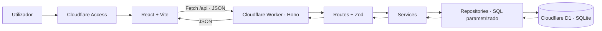

# Arquitectura do CloudExpense

O CloudExpense é um MVP académico de finanças pessoais com um único espaço financeiro partilhado. Não existem contas de utilizador nem isolamento por pessoa. Cloudflare Access controla quem pode entrar na demonstração, mas não transforma este MVP numa aplicação financeira multiutilizador.

## Fluxo

Em produção, um Worker serve a API e os ficheiros compilados de React através de Workers Static Assets. Todas as requisições passam pelo Worker antes dos assets para validar o JWT de Access. As rotas /api recebem JSON; outras rotas seguem para o binding ASSETS, com fallback SPA para navegação React.

Em desenvolvimento, Vite (5173) encaminha /api para Wrangler (8787). O runtime local executa Workers e D1 sem publicar código. Node.js executa ferramentas, não serve o backend de produção.

## Responsabilidades

| Área | Responsabilidade |
|---|---|
| frontend/src/pages | Dashboard, transacções, categorias e página inexistente |
| frontend/src/components | Layout, cartões, tabelas, modais, formulários e feedback |
| frontend/src/services | Único cliente Fetch, timeout, erros HTTP e serviços tipados |
| frontend/src/hooks | Consultas e mutações TanStack Query, invalidação de cache |
| shared/schemas.ts | Contratos TypeScript e validações Zod partilhadas |
| worker/src/routes | Endpoints HTTP, parsing de parâmetros e respostas |
| worker/src/services | Regras de categorias, transacções e relatórios |
| worker/src/repositories | Prepared statements e consultas D1 |
| worker/src/middlewares | Access, origem, erros e respostas seguras |
| worker/migrations | Estrutura, índices, constraints, triggers e categorias iniciais |

A pasta shared evita duplicar regras entre browser e Worker. Os componentes continuam sem acesso directo ao D1. O backend valida sempre os pedidos, mesmo quando o frontend já os validou.

## Dinheiro e datas

A API usa amountCents e a coluna amount é INTEGER. O formulário separa a parte inteira e decimal antes de calcular os centavos: "1500,50" resulta em 150050. Não se multiplica um valor decimal de ponto flutuante por 100. Cada movimento é limitado a 100.000.000.000 centavos.

Datas financeiras são datas civis YYYY-MM-DD, sem conversão de fuso horário. A validação rejeita datas inexistentes (por exemplo, 30 de Fevereiro). createdAt e updatedAt são timestamps UTC gerados no D1. A apresentação da data usa UTC para não deslocar o dia.

Todos os cartões do dashboard representam o ano seleccionado, incluindo o saldo do período; não são um saldo acumulado de todos os anos. A API summary sem filtros permite consultar o saldo global. Não há percentagens de crescimento inventadas.

## Integridade e concorrência

Chaves estrangeiras impedem referências órfãs. CHECK limita tipos, montantes e datas. Triggers impedem associar categorias incompatíveis e mudar o tipo de categorias utilizadas. A validação no service fornece mensagens claras; as constraints protegem também a base perante pedidos concorrentes. A verificação prévia, isoladamente, não seria suficiente.

O saldo não é persistido: SUM calcula receitas e despesas. A listagem obtém contagem e linhas numa operação D1 batch, com ordenação estável por data e id. Filtros partilham o mesmo construtor parametrizado. Caracteres especiais da pesquisa não se transformam em padrões arbitrários.

A paginação usa LIMIT/OFFSET; é simples e adequada ao MVP. Não há bloqueio optimista entre edições concorrentes: a última edição válida prevalece. Uma aplicação multiutilizador exigiria autorização por registo e uma política explícita de conflitos.

## Cache e experiência

TanStack Query mantém cache transitória no browser. As mutações aguardam a invalidação dos relatórios e listagens. O banco continua a ser a fonte de verdade. GET não é usado para escrever dados. Falhas de mutações não são repetidas automaticamente.

Os modais usam dialog nativo (foco contido, Escape e reposição de foco). Formulários apresentam erros, desactivam a submissão durante o pedido e mantêm os dados após uma falha. Listagens têm skeleton, estados vazios, erro e tentativa novamente.

## Segurança

Produção bloqueia pedidos se Access não estiver configurado. O Worker verifica assinatura RS256, issuer, audience e expiração do JWT com as chaves públicas da equipa. Não confia apenas na presença de um cabeçalho. A excepção local exige APP_ENV=development e hostname loopback.

O frontend não contém secrets. Escritas de outras origens são rejeitadas; não existe CORS permissivo. Todos os valores SQL variáveis usam binding. O corpo dos pedidos é limitado. Respostas incluem CSP e outras protecções. Logs estruturados contêm método, rota normalizada, status, duração e requestId; não contêm corpos, valores monetários nem descrições.

## Limites do MVP

Sem contas, orçamentos, exportações, moedas múltiplas ou sincronização em tempo real entre browsers. As requisições de cartões/gráficos são independentes: uma escrita concorrente pode produzir diferenças transitórias entre relatórios, resolvidas pela próxima consulta. Não se afirma suporte a cargas empresariais sem medição.